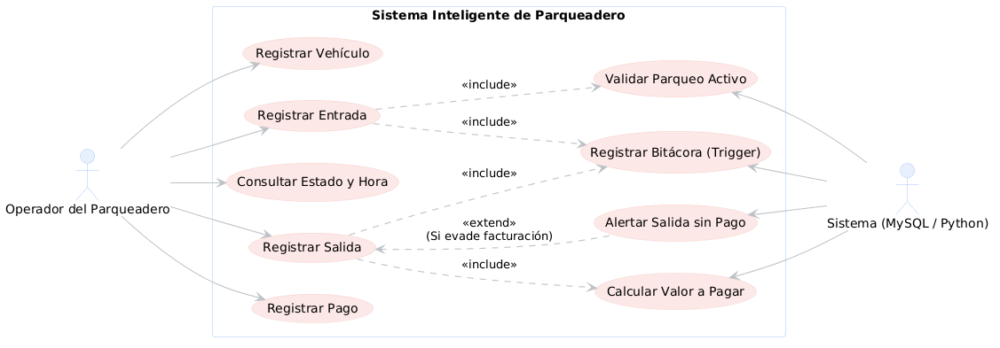
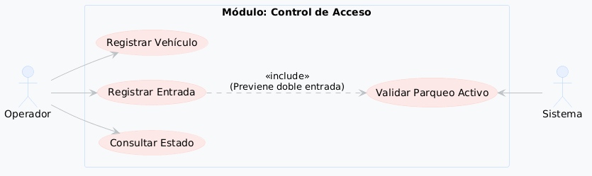
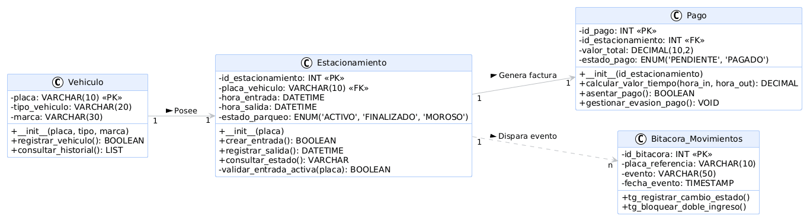
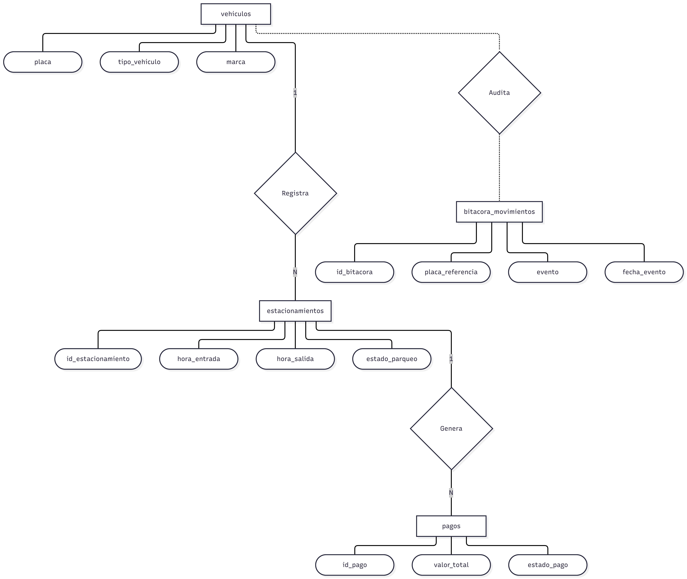
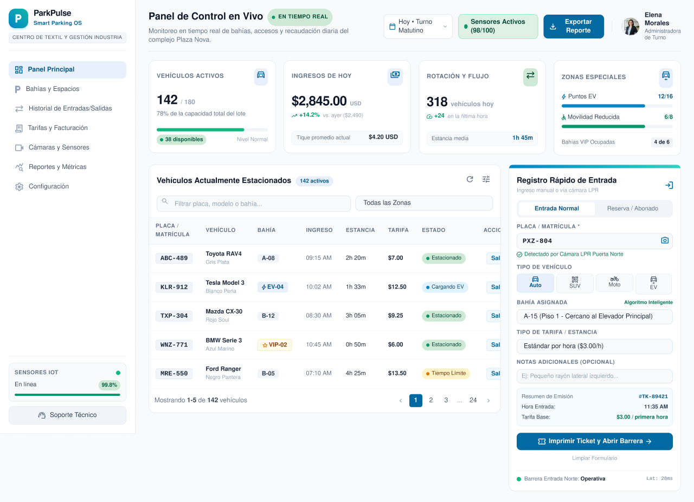
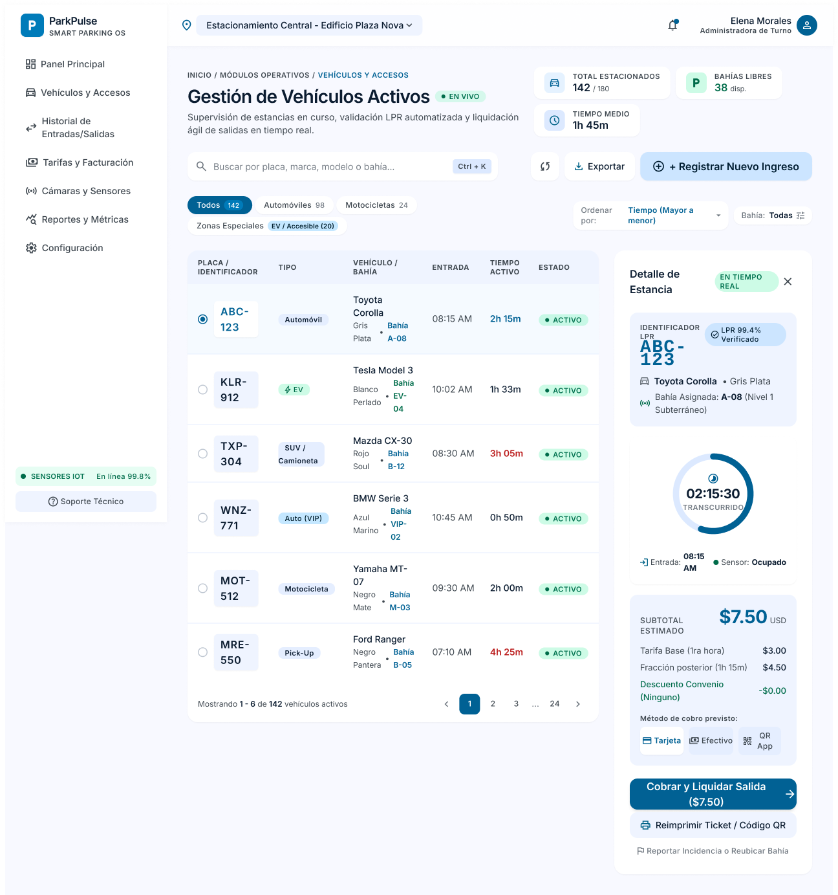
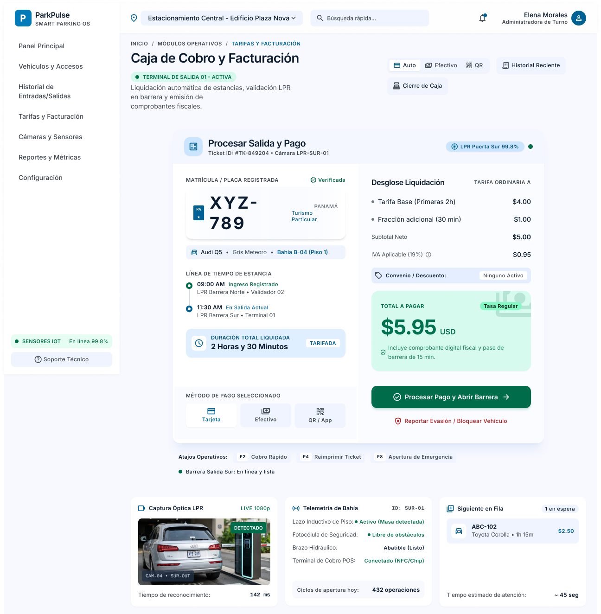
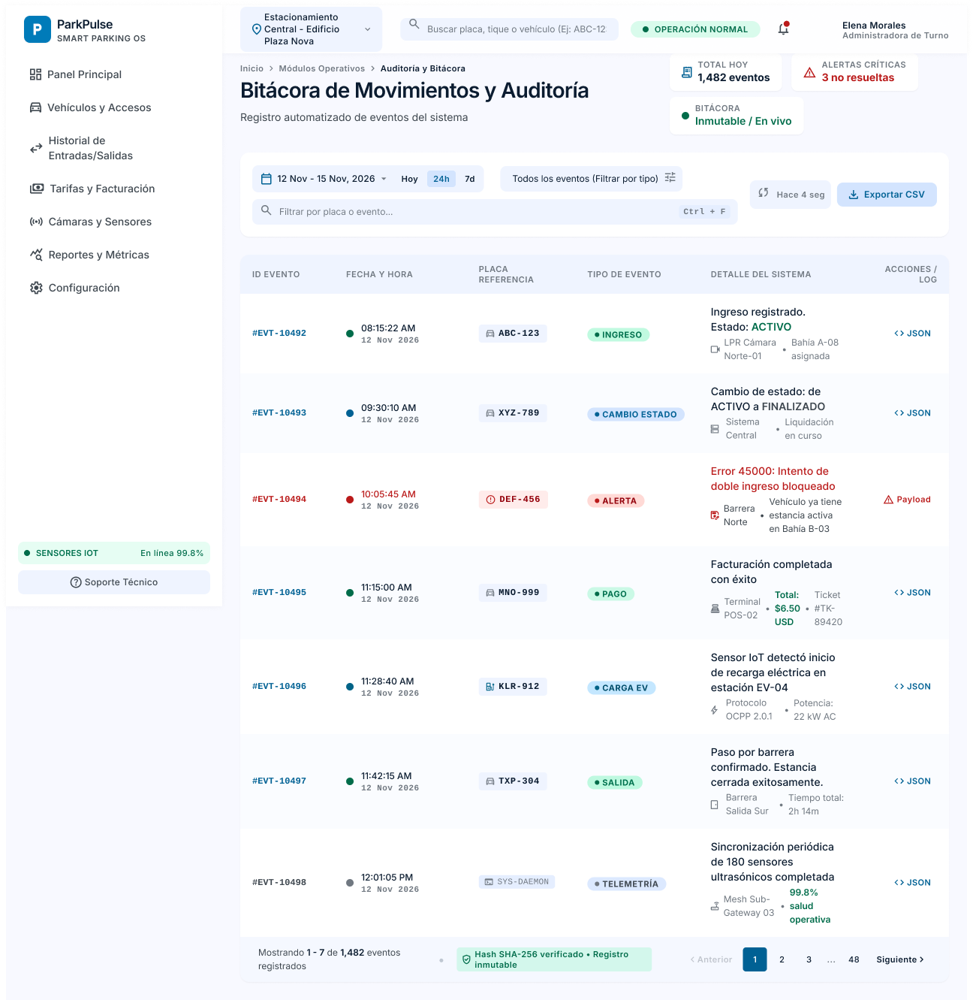

# 🚗 Sistema Inteligente de Parqueadero

Sistema integral para la gestión, control de tiempos y facturación de un estacionamiento, diseñado con un enfoque modular y arquitectura relacional.

## 📐 Arquitectura y Modelado

### 1. Diagramas de Casos de Uso
Define la interacción entre los operadores del parqueadero y los procesos automatizados del sistema.

  

  

### 2. Diagrama de Clases
Estructura orientada a objetos que define las entidades del sistema, sus atributos y comportamientos.

  

### 3. Modelo Entidad-Relación (Conceptual)
Abstracción de las reglas de negocio y cardinalidad entre vehículos, estacionamientos y pagos.

  

## 🎨 Diseño de Interfaz (Mockups)

El diseño del sistema sigue una estética SaaS limpia, minimalista y orientada a la eficiencia operativa, utilizando una paleta de colores basada en tonos azul pastel, verde menta y gris claro.

A continuación, se presentan las vistas principales del aplicativo:

  
| 🏠 Landing Page & Autenticación | 📊 Dashboards & Control |
| :---: | :---: |
| **Landing Page**   | **Panel Principal**   |
| **Inicio de Sesión**   | **Gestión de Vehículos**   |
| **Registro de Usuario**   | **Módulo de Cobro**   |

### 🛡️ Auditoría del Sistema

  
   
  <i>Vista del registro inmutable generado automáticamente por los triggers de MySQL.</i>

## 🛠️ Tecnologías Utilizadas
* **Base de Datos:** MySQL
* **Lógica y Triggers:** MySQL
* **Modelado:** PlantUML / Mermaid / Notación de Chen
