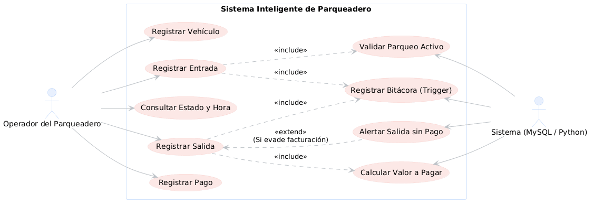
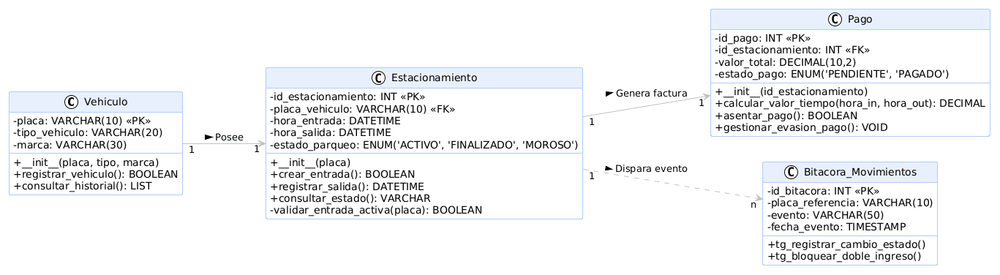
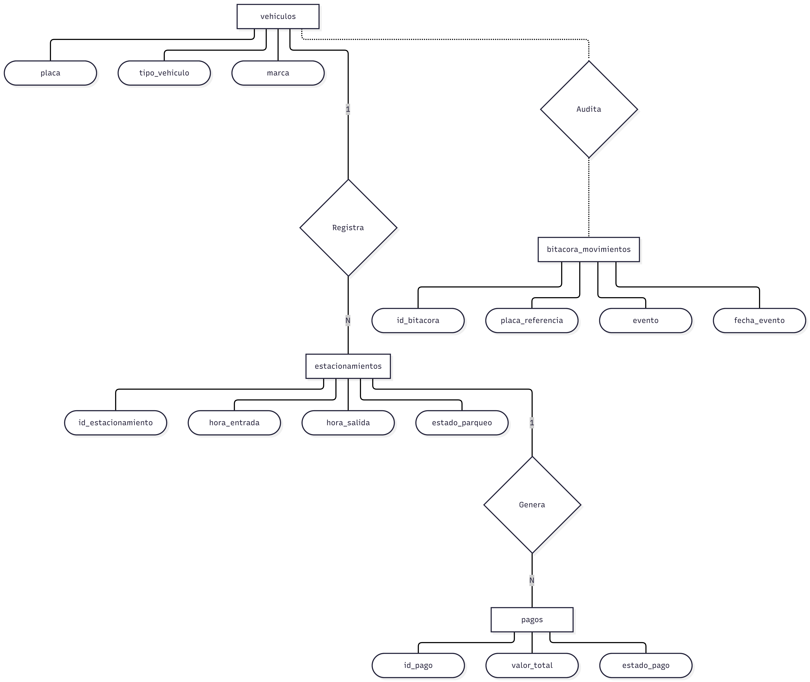

# 🚗 Sistema Inteligente de Parqueadero

Sistema integral para la gestión, control de tiempos y facturación de un estacionamiento, diseñado con un enfoque modular y arquitectura relacional.

## 📐 Arquitectura y Modelado

### 1. Diagrama de Casos de Uso
Define la interacción entre los operadores del parqueadero y los procesos automatizados del sistema.

  

### 2. Diagrama de Clases
Estructura orientada a objetos que define las entidades del sistema, sus atributos y comportamientos.

  

### 3. Modelo Entidad-Relación (Conceptual)
Abstracción de las reglas de negocio y cardinalidad entre vehículos, estacionamientos y pagos.

  

## 🛠️ Tecnologías Utilizadas
* **Base de Datos:** MySQL
* **Lógica y Triggers:** MySQL
* **Modelado:** PlantUML / Mermaid / Notación de Chen

## 🚀 Instalación y Despliegue
1. Clonar el repositorio: `git clone <url-del-repo>`
2. Ejecutar el script `script_db.sql` en tu gestor de MySQL (ej. XAMPP o MySQL Workbench).
