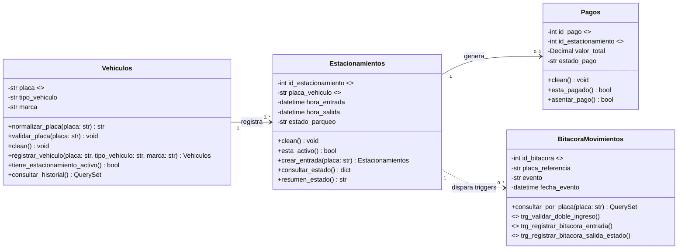

# Diagrama de Clases UML — Sistema de Parqueadero Inteligente

Este documento complementa y corrige el diagrama visual existente ([clases.png](clases.png)) para cumplir al 100% el **criterio 1.1**, manteniéndose alineado exactamente con `database/01_esquema_y_triggers.sql` y `app_parqueadero/models.py`.

## Correcciones aplicadas respecto a `clases.png`

1. **Cardinalidad `Vehiculos` -> `Estacionamientos`:** corregida de `1` a `1` hacia **`1` a `0..*`**, ya que un mismo vehículo puede tener múltiples ingresos históricos en el parqueadero (el trigger `trg_validar_doble_ingreso` restringe únicamente ingresos `ACTIVO` simultáneos).
2. **Cardinalidad `Estacionamientos` -> `Pagos`:** ajustada a **`1` a `0..1`**, porque un estacionamiento `ACTIVO` todavía no tiene pago generado hasta su salida.
3. **Longitud de `evento` en `BitacoraMovimientos`:** alineada con el script SQL (`VARCHAR(100)` en lugar de `VARCHAR(50)`).
4. **Triggers reflejados fielmente:** `trg_validar_doble_ingreso`, `trg_registrar_bitacora_entrada` y `trg_registrar_bitacora_salida_estado`.

## Diagrama UML (Mermaid)

